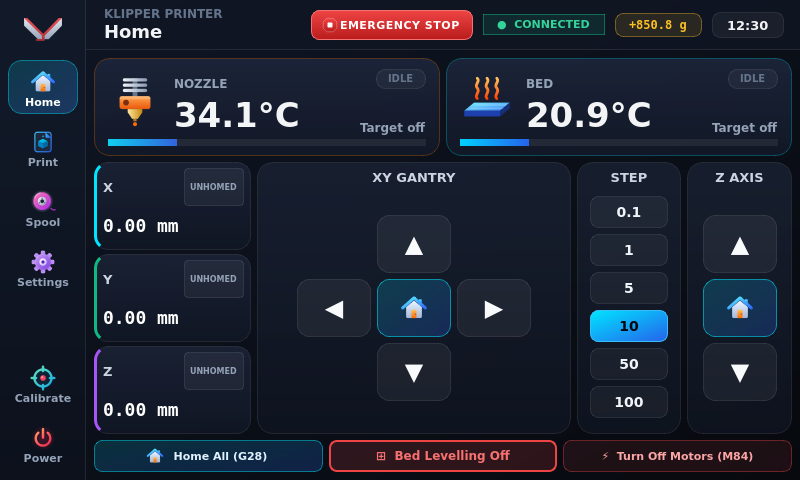
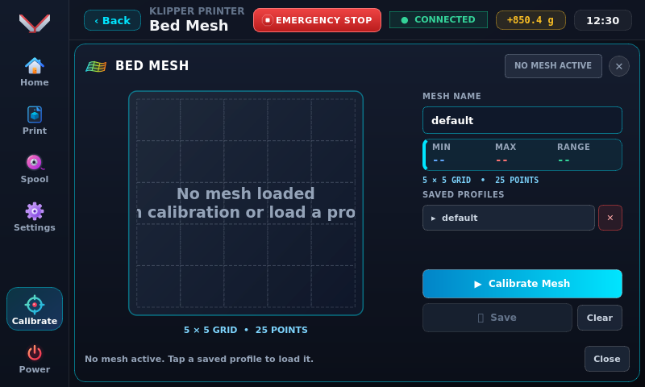
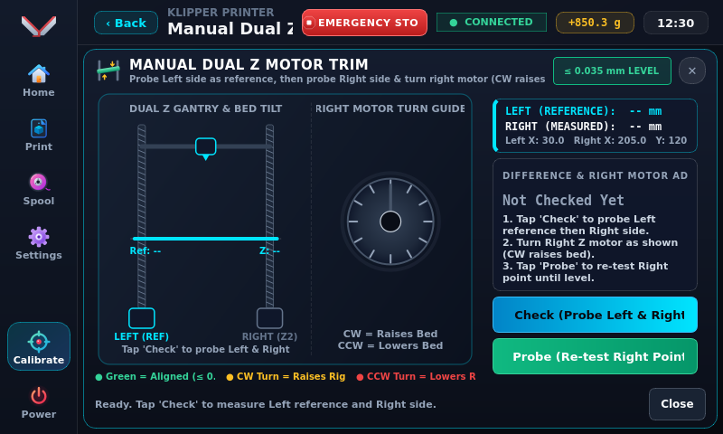
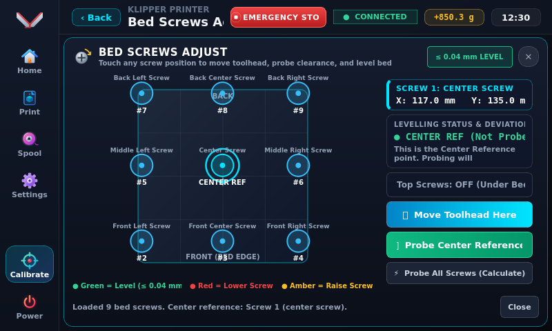
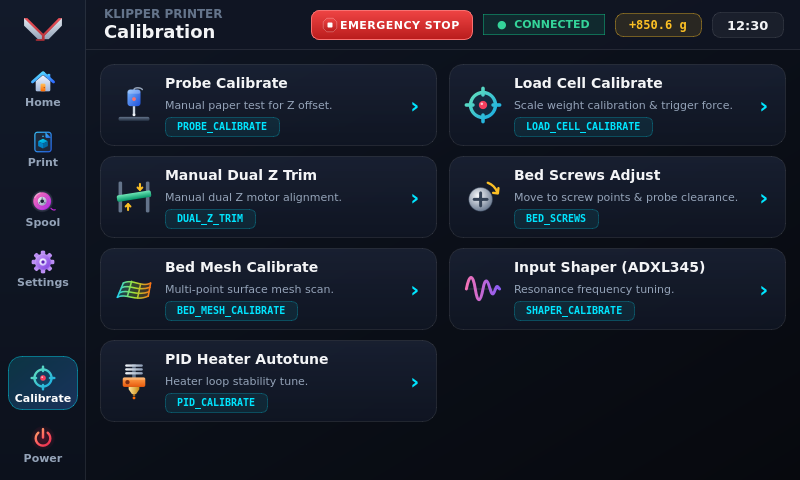
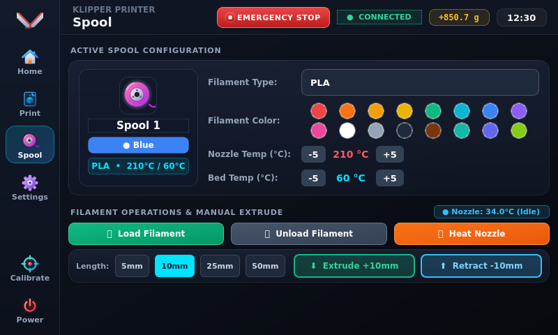
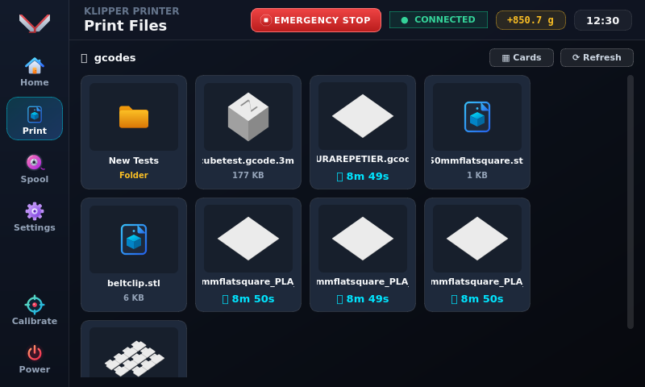
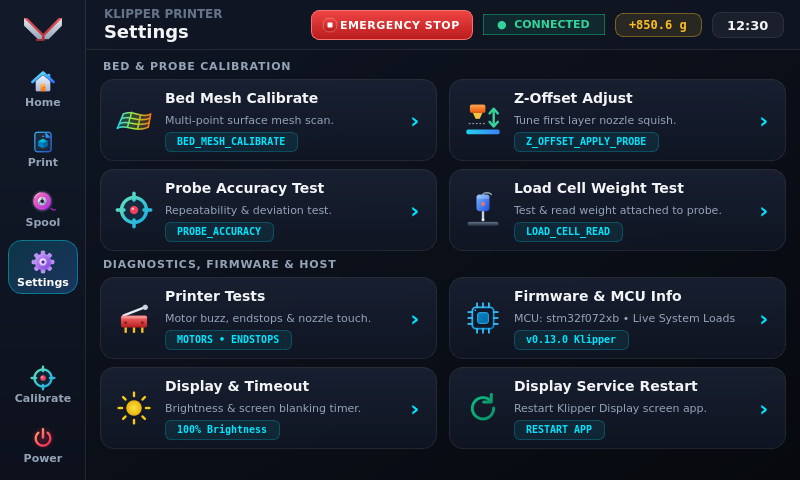

# 🚀 Klipper Touch Display

A modern, high-performance, dark-themed touchscreen interface for **Klipper 3D Printers** and **Moonraker**.

Designed from the ground up for responsive touchscreens (7-inch, 5-inch, 4.3-inch, HDMI/DSI/SPI), featuring interactive visual calibration tools, real-time telemetry, and hardware-accelerated rendering.

---

## 📸 Touchscreen Interface & Screenshots

Captured directly from a Raspberry Pi running the 800×480 touchscreen interface:

| **Main Dashboard & Live Telemetry** | **Live Bed Mesh Calibration** |
|:---:|:---:|
|  |  |
| *Live nozzle/bed temperatures, real-time load cell force readout, XY jog controls & printer status* | *Visual bed heightmap, real-time probe point tracking & toolhead sync* |

| **Manual Dual Z Motor Trim** | **Bed Screws Adjustment** |
|:---:|:---:|
|  |  |
| *Independent leadscrew alignment with live tilt angle and CW/CCW turn guides* | *Guided bed leveling with screw corner directions and live probe measurements* |

| **Interactive Calibration Hub** | **Spool & Filament Manager** |
|:---:|:---:|
|  |  |
| *Unified hub for Z-offset, load cell tare, mesh, shaper, screws, and PID autotune* | *One-touch load/unload workflows, material presets & animated extrusion gears* |

| **G-Code File Browser** | **System & Display Settings** |
|:---:|:---:|
|  |  |
| *Print file browser with metadata, estimated time, and thumbnail previews* | *Host system telemetry, network status, display options, and service controls* |

---

## ✨ Features

- **🎯 Z-Offset & Paper Friction Calibration**:
  - Interactive nozzle clearance & squish visual diagram.
  - **Paper Friction Test**: Automated homing check, moves nozzle to probe center, and lowers smoothly to `Z=0.00 mm`.
  - **Live Jog Adjustments**: Step buttons (`0.005mm` to `0.100mm`) execute real-time physical micro-moves (`SET_GCODE_OFFSET MOVE=1`) so you feel friction change on the paper immediately.
  - 2-tap armed `SAVE_CONFIG` writes new offset permanently to `printer.cfg`.

- **⚡ Input Shaper Calibration**:
  - Direct integration with `adxl345`, `lis2dw`, and `mpu9250` resonance testers.
  - Live frequency vibration sweep telemetry (5 Hz to 135 Hz).
  - Automatically parses and displays recommended algorithms (`MZV`, `EI`, `2HUMP_EI`, `3HUMP_EI`) with one-tap `SAVE_CONFIG`.

- **📐 Bed Mesh Visualizer**:
  - Dynamically detects your configured mesh grid from `printer.cfg` (supports both rectangular beds and circular/delta beds).
  - Live probe point counters and visual inspection diagram.

- **🎯 Probe Accuracy Test**:
  - Standard deviation, range, min, and max calculations with live sample counting.

- **⚖️ Load Cell Calibration & Live Tare**:
  - Real-time nozzle contact force monitoring in grams.
  - Nozzle test tap verification, empty tare zeroing, and 2-step calibration with known reference weight.

- **🔥 Thermal & Extruder Management**:
  - Beautiful preheat popups for PLA, PETG, ABS, TPU, and custom targets.
  - Animated extruder feed gears during extrusion and retraction.

- **🧵 Filament & Spool Manager**:
  - Step-by-step load, unload, purge, and cold pull workflows.

---

## 🖥️ Requirements

- **Supported Hardware**: Raspberry Pi (3B+, 4B, 5, Zero 2W), BTT Pi, CB1, Orange Pi, or any Linux PC/SBC.
- **Operating System**: Raspberry Pi OS (Debian Bullseye / Bookworm), Ubuntu, Armbian, or Linux Mint.
- **Backend**: Working [Klipper](https://github.com/Klipper3d/klipper) and [Moonraker](https://github.com/Arksine/moonraker) installation.

---

## 📦 Installation

Clone this repository to your printer host (e.g., Raspberry Pi) and run the automated installer:

```bash
cd ~
git clone https://github.com/OversizedWizard/KlipperDisplayMoonraker.git
cd KlipperDisplayMoonraker
chmod +x install.sh
./install.sh
```

---

## 🔄 Updating

To update an existing installation on your Raspberry Pi and restart the display service:

```bash
cd ~/KlipperDisplayMoonraker
git pull
sudo systemctl restart klipper-display 2>/dev/null || sudo systemctl restart klipperscreen
```

*(If updating from an older version where `chmod +x` caused a local file-mode conflict, run this once to reset cleanly:)*

```bash
cd ~/KlipperDisplayMoonraker && git config core.fileMode false && git fetch origin && git reset --hard origin/main && (sudo systemctl restart klipper-display 2>/dev/null || sudo systemctl restart klipperscreen)
```

---

## 🛠️ Installer Options

The installer is completely interactive and handles system dependencies, Python virtual environment, and startup configuration:

### 1. Existing KlipperScreen Detection
The installer automatically scans for existing `KlipperScreen.service` or autostart desktop entries:
```text
[!] Detected existing Klipper display startup:
    • Systemd Service: KlipperScreen.service
Would you like to disable and replace the existing display startup? (y/n) [default: y]:
```
- Choosing **`y`** safely stops, disables, and masks the existing service so there are no display conflicts.

### 2. Startup Mode Selection
Choose how your display boots:
```text
Choose how you want Klipper Display to run on your system:
  [1] Boot straight to app (Dedicated Kiosk Mode - Recommended)
      • Boots directly into Klipper Display in fullscreen on startup.
      • Standalone display session, disables desktop overhead.
      • Touchscreen optimized with hidden mouse cursor.
      • Matches standard KlipperScreen behavior.

  [2] Desktop Mode with Shortcut
      • Keeps / re-enables standard Raspberry Pi OS Desktop.
      • Creates a desktop launcher icon (~/Desktop/KlipperDisplay.desktop).
      • Launch the display whenever you need by double-clicking.
```

---

## 🎮 Manual Run & Command-Line Flags

To test or run manually from the terminal:

```bash
# Fullscreen kiosk on touchscreen (hides mouse cursor):
./launch.sh

# Windowed mode on desktop:
./launch.sh --desktop

# Direct Python run with custom resolution:
python3 main.py --width 1024 --height 600
```

### Available Arguments
| Flag | Description |
|------|-------------|
| `--fullscreen` | Runs window in borderless fullscreen mode. |
| `--hide-cursor` | Hides the mouse pointer for touchscreen use. |
| `--width <pixels>` | Sets custom window width (default: 800). |
| `--height <pixels>` | Sets custom window height (default: 480). |

---

## 🔧 Service Management

If installed in **Kiosk Mode**, control the service using standard `systemctl` commands:

```bash
# Restart the display service:
sudo systemctl restart klipper-display

# Stop the display service:
sudo systemctl stop klipper-display

# Check live service status:
sudo systemctl status klipper-display

# View live application logs:
journalctl -u klipper-display -f
```

---

## 🗑️ Uninstallation

If you ever wish to remove the display or restore your previous KlipperScreen setup:

```bash
chmod +x uninstall.sh
./uninstall.sh
```
The uninstaller removes the service, deletes desktop icons, and offers to unmask and re-enable your original `KlipperScreen.service`.

---

## 📷 Camera Setup (CSI / OV5647 + Official 7" DSI Touchscreen)

If running a **CSI Camera (e.g. 5MP OV5647)** alongside the **Official Raspberry Pi 7" DSI Touchscreen Display**, both devices share the internal Unicam/DSI I2C bus (`i2c-10` on `i2c0mux`). 

### 1. Boot Configuration (`/boot/firmware/config.txt`)
Under modern Raspberry Pi OS (Bullseye / Bookworm / Trixie) with KMS graphics, the touchscreen is managed natively by the kernel's `edt-ft5406` driver. Do **NOT** use legacy firmware touch overlays:

```ini
# Auto-detect camera sensor (OV5647) and DSI panel
camera_auto_detect=1
display_auto_detect=1

# Modern KMS Graphics Driver (Required for direct kernel touch + camera)
dtoverlay=vc4-kms-v3d
max_framebuffers=2

# ⚠️ CRITICAL: Ensure legacy firmware touch & floating GPIO lines are DISABLED:
# DO NOT include dtoverlay=rpi-ft5406 (forces GPU polling of 0x38 at 60Hz, locking the shared I2C bus and killing the camera)
# DO NOT include dtoverlay=w1-gpio unless an actual 1-wire sensor is wired to GPIO 4
```

### 2. Dedicated Camera Streamer Service (`klipper-cam.service`)
Create `/etc/systemd/system/klipper-cam.service`:

```ini
[Unit]
Description=OV5647 Camera Streamer
After=network.target

[Service]
User=pi
Type=simple
ExecStart=/usr/bin/camera-streamer \
  --camera-type=libcamera \
  --camera-format=YUYV \
  --camera-width=1296 \
  --camera-height=972 \
  --camera-fps=30 \
  --camera-nbufs=3 \
  --http-listen=0.0.0.0 \
  --http-port=8080
Restart=always
RestartSec=5

[Install]
WantedBy=multi-user.target
```

Enable and start the service:
```bash
sudo systemctl daemon-reload
sudo systemctl enable --now klipper-cam.service
```

### 3. Alternative: Crowsnest Configuration (`crowsnest.conf`)
If you manage your stream with Crowsnest instead of a standalone systemd service, configure `/home/pi/printer_data/config/crowsnest.conf`:

```ini
[crowsnest]
log_level: verbose
rollover_on_start: false
no_proxy: true

[cam 1]
mode: camera-streamer
port: 8080
device: /base/soc/i2c0mux/i2c@1/ov5647@36
resolution: 1296x972
max_fps: 30
custom_flags: --camera-format=YUYV
```

### 4. Streaming Endpoints
* **Live MJPEG Stream**: `http://<pi-ip>:8080/?action=stream` or `http://<pi-ip>/webcam/?action=stream`
* **Direct High-Res Snapshot**: `http://<pi-ip>:8080/?action=snapshot` or `http://<pi-ip>/webcam/?action=snapshot`
* **Ultra-Low Latency WebRTC**: `http://<pi-ip>:8080/webrtc`

---

## 📄 License
This project is licensed under the MIT License. See `LICENSE` for details.

